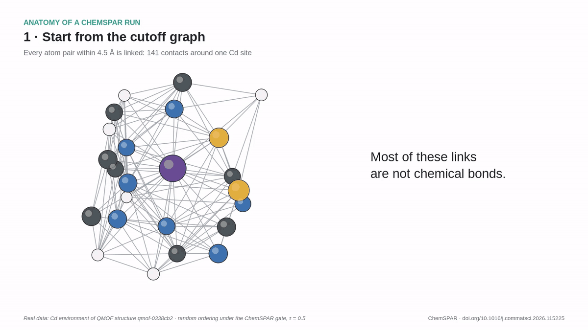

# ChemSPAR

**An auditable, chemistry-constrained framework for sparsifying periodic graphs of metal–organic frameworks.**

[](https://doi.org/10.1016/j.commatsci.2026.115225)
[](https://doi.org/10.5281/zenodo.23475531)
[](LICENSE)

ChemSPAR prunes the periodic contact graph of a crystal (every atom pair within 4.5 Å, one edge per lattice image) under
an explicit chemistry taxonomy and protection gate. Any edge-ordering policy can be plugged in, and every removal
attempt is written to an audit log.

<p align="center">
  
</p>

<p align="center"><em>One real ChemSPAR run on the Cd environment of QMOF structure qmof-0338cb2 (random ordering under the gate,
τ = 0.5): 141 contacts → 83 kept, all 20 protected bonds intact, 12 refusals logged with their reasons.</em></p>

## What it does
1. **Contact instances.** Each periodic contact `(i, j, image)` is a separate edge, and the model input is built
   directly from the retained instances (no neighbour list is rebuilt).
2. **Taxonomy (first match wins).** Protected: `covalent_radius`, `metal_ligand`, `metal_metal_crystalnn`.
   Removable, audited: `hydrogen_bond_candidate`, `crystalnn_nonmetal`, `metal_contact`, `other_contact`.
   Radius route `d ≤ r_i + r_j + 0.40 Å` (Cordero radii); CrystalNN route via pymatgen (`configs/chemistry_v1.yaml`).
3. **Gate.** In rank order until ⌊τ·|E|⌋ contacts are removed: keep if (1) protected, (2) a non-H atom would lose its
   last contact, (3) the graph would disconnect; otherwise remove. The *ungated* partner omits check (1).
4. **Orderings.** Gravity, distance (longest first), random and an edge-level adaptation of the Black Hole Strategy
   node score (equal weights, as published).

Paper names ↔ internal keys: Gravity-Chem = `ChemSPAR-v2`, Gravity = `ChemSPAR-v2-noGate`, Distance-Chem =
`Distance-Chem`, Distance = `Distance`, Random-Chem = `Random-Chem`, Random = `Random`, BHS-Chem = `BHS-edge-min`,
BHS = `BHS-edge-min-noGate` (also listed in `configs/final_v1.yaml`).

## Installation
```bash
python3.9 -m venv .venv && source .venv/bin/activate
pip install -r requirements.txt
```
All results were produced on CPU (training is bitwise reproducible at a fixed thread count).

## Data
Download the QMOF database (Rosen et al., *Matter* 2021; *npj Comput. Mater.* 2022) and set
`QMOF_DIR` to the folder that contains `qmof.csv`, `qmof.json` and `relaxed_structures_full_v1/` (one CIF per
structure). The fixed 5,000-structure cohort and its train/validation/test split are in `data/cohort_5000_v1.csv`.
```bash
export QMOF_DIR=/path/to/qmof_database
```
Configuration hashes and software versions used in the paper are recorded in `configs/FROZEN.json`.

## Reproducing the paper
```bash
python scripts/p2_build_cohort.py                    # cohort and split (already provided in data/)
python scripts/p2i_build_instance_views.py           # contact instances, taxonomy, removal ranks of every policy
python scripts/p2i_analyse.py                        # structural tables (taxonomy, constructions, validity)
python scripts/p3_build_tensors.py                   # tensor store + proofs that each tensor equals its view
python scripts/p4_structural_tradeoff.py 4           # structural endpoints of all views
python scripts/p4_audit_summary.py                   # audit-log summary
python scripts/p4_budget_extension.py Original-4.5   # epoch budget (also ChemSPAR-v2@0.2, ChemSPAR-v2@0.5), then: decide
python scripts/p4_run_final.py preflight             # determinism and smoke checks
python scripts/p4_run_final.py worker 0              # final fits (start workers 0, 1, 2 in parallel)
python scripts/p4_analyse_final.py cgcnn             # pre-specified paired analysis
python scripts/p4_cost_benchmark.py all              # cost benchmark (run on an otherwise idle machine)
python scripts/check_final_numbers.py                # independent recomputation of the paper's tables
```
Revision analyses (no new training): `scripts/p5_structural_revision.py` (sweep and weight sensitivity), `scripts/p5_voronoi.py`, `scripts/p5_posthoc.py`, `scripts/p6_structural_extras.py`, and `scripts/ms_make_revision.py`. The size-matched geometric-gate comparison is `scripts/p7_geogate_structural.py` with `configs/geogate_v1.yaml`.

Figures: `scripts/fig1_export.py`, then open `figures/fig1_build/render.html` through `scripts/fig1_render_server.py`
(download 3Dmol.js into `figures/fig1_build/`, e.g.
`curl -o figures/fig1_build/3Dmol-min.js https://cdnjs.cloudflare.com/ajax/libs/3Dmol/2.4.2/3Dmol-min.js`),
then `scripts/fig1_compose.py`, `scripts/ms_make_results.py` and `scripts/fig_graphical_abstract.py`.

## Tests
```bash
python -m pytest -q tests
```
Tests that compare with the earlier, pre-ChemSPAR code are skipped (that code is not part of this repository).

## Large outputs
Graph views, complete audit logs and per-fit predictions are at https://doi.org/10.5281/zenodo.23475531 (CC-BY-4.0).

## Citation
If you use ChemSPAR, please cite:

> M. Jalali, B. Vu, S. Chandna, M. H. Nadimi-Shahraki. ChemSPAR: An auditable, chemistry-constrained framework for
> sparsifying periodic graphs of metal–organic frameworks. *Computational Materials Science* **277** (2027) 115225.
> https://doi.org/10.1016/j.commatsci.2026.115225

```bibtex
@article{jalali2027chemspar,
  title   = {ChemSPAR: An auditable, chemistry-constrained framework for sparsifying periodic graphs of metal--organic frameworks},
  author  = {Jalali, Mehrdad and Vu, Binh and Chandna, Swati and Nadimi-Shahraki, Mohammad H.},
  journal = {Computational Materials Science},
  volume  = {277},
  pages   = {115225},
  year    = {2027},
  doi     = {10.1016/j.commatsci.2026.115225}
}
```

## License
MIT (see `LICENSE`).
